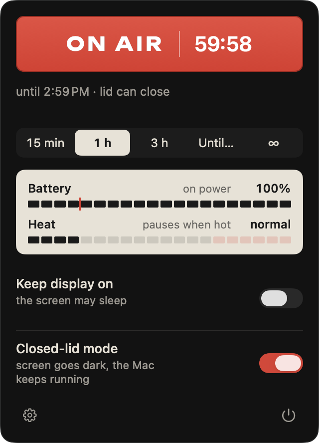
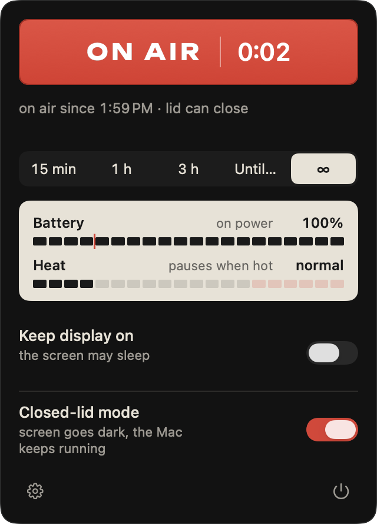
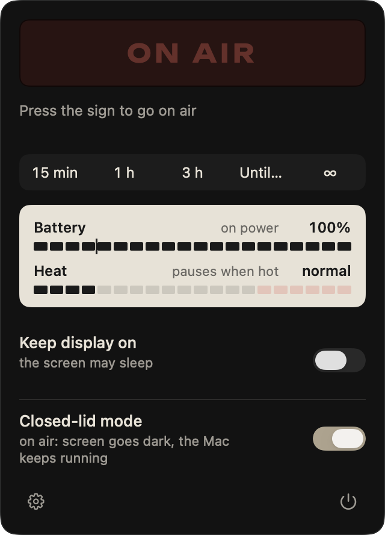
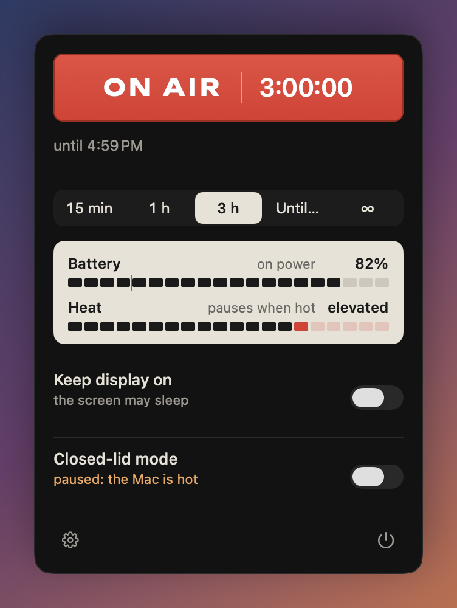

<p align="center">
  
</p>

<h1 align="center">Lidless</h1>

<p align="center">
  <b>Keep your Mac awake — even with the lid closed — and never leave it unable to sleep.</b><br>
  A native macOS menu-bar app with an ON AIR sign you press to go on air.
</p>

<p align="center">
  
  
  
  <a href="LICENSE"></a>
</p>

<p align="center">
  English · <a href="README.ru.md">Русский</a>
</p>

<p align="center">
  
  &nbsp;
  
  &nbsp;
  
</p>

---

## Why Lidless

Most keep-awake utilities stop at "don't sleep while the lid is open". Lidless is built for the moments when you actually walk away:

- **Works with the lid closed.** Close the lid and the screen goes dark, but the Mac keeps running your build, download, render, AI agent, SSH session or AirPlay stream. With an external display connected, Lidless leaves your screens alone.
- **Guards itself.** A session stops on low battery, closed-lid mode pauses when the Mac gets hot, and a time limit stops a forgotten laptop from cooking in a bag. If the Mac is critically hot with the lid closed, the session ends.
- **Never leaves your Mac broken.** Quitting Lidless restores normal sleep. If it crashes or is force-quit, normal sleep returns at once; if the Mac reboots mid-session, it is reset at boot. The only privileged command Lidless can run is `pmset -a disablesleep 0|1`, besides removing the 0.2.0 helper once.
- **One press.** The ON AIR sign *is* the button. Press it to go on air, press it again to go off air. The sign counts down a timed session or counts time on air for an indefinite one.
- **Honest at a glance.** While on air the menu-bar icon is a small lit red lamp; with a timer its light burns down as time runs out. An orange dot means something needs your attention.
- **Native and private.** SwiftUI + AppKit, a universal binary, no network access, no analytics, no accounts.

## Features

| | |
|---|---|
| **Sessions** | 15 min, 1 h, 3 h (presets are editable), *Until…* a time of day, or indefinitely (∞). Pick a length to start right away or to restart a running session with a new length. |
| **The sign** | Press it (or hit Return) to go on air / off air. Lit red while on air, with a countdown or time-on-air clock; dark glass when off. |
| **Display** | *Keep display on* keeps the screen lit; otherwise the screen may sleep while the Mac stays awake. |
| **Closed-lid mode** | The Mac keeps running with the lid shut; the screen turns off at once. Needs a one-time approval of the helper in System Settings ([details](#closed-lid-mode-and-the-helper)). |
| **Safety meters** | Battery and heat as studio meters on the panel, with the battery stop line drawn in. |
| **Notifications** | A heads-up 5 minutes before a timed session ends, with **+30 min** and **+1 h** buttons; a note when a safety rule stops or pauses something. |
| **Menu-bar icon** | A quiet line when off; a lit lamp on air; optional remaining-time text next to it. |
| **Settings** | Launch at login, default length, presets, menu-bar timer text, start a session at launch, safety thresholds, helper setup and removal, and the interface language. |
| **Languages** | English and Russian, switchable in Settings → General → Language (independent of the system language). |

### Menu-bar icon

<p>
  
  <br>
  
</p>

Left to right: **off** · **on air** · **on air with a timer** (the lamp's light burns down; remaining time shown) · **on air in closed-lid mode** (a horizon line under the lamp) · **needs attention** (a safety rule fired, or the helper is unavailable).

### Safety rules



| Rule | Default | What happens |
|---|---|---|
| Low battery | on, 20% (5–50%) | On battery below the threshold the session stops; a session will not start below it. |
| Heat | on | At *serious* thermal pressure closed-lid mode pauses (the session goes on); at *critical* pressure with the lid closed the session stops. |
| Closed-lid time on battery | on, 4 h (30 min–12 h) | After that long closed on battery, closed-lid mode pauses. |

Every rule can be turned off or tuned in **Settings → Safety**.

<br clear="right">

## Install

1. Download `Lidless.dmg` from [Releases](https://github.com/aesarva/lidless/releases) and open it.
2. Drag **Lidless** onto the **Applications** shortcut, then launch it. It lives only in the menu bar (no Dock icon).

Releases are signed with a Developer ID and notarized by Apple, so Lidless opens like any other app. Requires macOS 14 Sonoma or later, on Apple Silicon or Intel.

## Quick start

1. Click the menu-bar icon.
2. Press the **ON AIR** sign — or pick a length (15 min, 1 h, 3 h, *Until…*, ∞) to start with it.
3. Want to close the lid? Turn on **Closed-lid mode** (the first time, Lidless asks you to approve its helper in System Settings — no password).
4. Press the sign again to go off air. Quitting Lidless also ends the session and restores normal sleep.

Click the icon again or press Esc to close the panel. Right-click the icon for a quick menu.

## Closed-lid mode and the helper

Ordinary sessions use a standard macOS power assertion and need nothing extra. Keeping a Mac awake with the lid closed (without an external display) needs `pmset -a disablesleep 1`, which requires root. For that, Lidless ships a small helper daemon inside the app and registers it with macOS (`SMAppService`). The first time you turn closed-lid mode on, macOS shows a notification and opens **System Settings → General → Login Items & Extensions**; switch Lidless on under **Allow in the Background**. You do this once, with no password, and closed-lid mode then turns on by itself.

| Path | Purpose |
|---|---|
| `Lidless.app/Contents/MacOS/LidlessHelper` | the helper daemon; runs as root, started by macOS on demand and at boot |
| `Lidless.app/Contents/Library/LaunchDaemons/io.github.aesarva.Lidless.helper.plist` | the launchd job description that `SMAppService` registers |
| `/Library/Application Support/Lidless/sleep-owned` | state file, written only while the helper has turned `disablesleep` on |

Closed-lid mode is tied to Lidless's live connection to the helper. If Lidless quits, crashes or is force-quit, the helper restores normal sleep at once. If the Mac reboots mid-session, the helper sees `sleep-owned` at boot and resets `disablesleep`. If the helper crashes, macOS starts it again and Lidless re-applies closed-lid mode. If you switch Lidless off in Login Items, macOS quits Lidless and normal sleep is restored. Lidless never touches a `disablesleep` you set yourself.

When the lid closes in closed-lid mode, Lidless turns the screen off (`pmset displaysleepnow`, no privileges needed) and keeps the Mac awake; when the lid opens, your display choice applies again.

### Security model

- **One command.** The helper's only privileged action is `pmset -a disablesleep 0|1`. It takes no paths or arguments from the app beyond that on/off choice. The one exception is the one-time removal of the 0.2.0 helper when the new helper first starts (`launchctl bootout` of its watchdog job and deleting its files).
- **Signature checks both ways.** The helper accepts connections only from Lidless signed by the same Developer ID team as the helper, and Lidless connects only to a helper signed by that team. A build with no team (ad-hoc) is refused on both sides. macOS also refuses to launch the helper at all if its code signature no longer matches.
- **Reset on disconnect and at boot.** Normal sleep returns when the connection ends and, after a reboot, at boot.
- **Run from one location.** Run Lidless from one location (for example `/Applications`): macOS ties the registration to the bundle path.
- **If the helper crashes** while closed-lid mode is on, macOS starts it again and Lidless re-applies closed-lid mode. **If you switch Lidless off** in Login Items, macOS quits Lidless and normal sleep is restored.

### Upgrading from 0.2.0

Version 0.2.0 installed a sudoers rule, a root watchdog script and a launchd job. When you approve the new helper, it removes all of them (and the old marker file) before accepting any connection. Lidless retries once per launch if any files remain, and Settings → Helper shows "The 0.2.0 helper was removed." or an error line. If a 0.2.0 closed-lid session was cut short and you have not approved the new helper yet, Lidless resets `disablesleep` at launch through the old rule (`sudo -n pmset -a disablesleep 0`, no password). You do not need to run anything by hand.

### Uninstall

Open **Settings → Helper → Remove** (it turns closed-lid mode off first and needs no password), then delete `Lidless.app`. If you deleted the app first, switch the leftover Lidless entry off in **System Settings → General → Login Items & Extensions**.

## Privacy

Lidless makes no network requests, collects no analytics and needs no account. It reads battery level, power source, thermal state and the lid sensor locally to apply its safety rules.

## Build from source

Requirements: Xcode 16 or later and

```sh
brew install xcodegen shellcheck
```

```sh
make test      # Swift package tests, shellcheck, helper plist lint
make build     # generate the Xcode project and build (Debug)
make run       # build and launch the Debug app
make app       # Release universal build (arm64 + x86_64), hardened runtime → build/Lidless.app
make dmg       # make app + dist/Lidless-<VERSION>.dmg without a Developer ID (VERSION=0.3.0 by default)
```

`scripts/build-app.sh` honours `ARCHS` (e.g. `ARCHS=arm64`), `VERSION` and `SIGN_IDENTITY` (default `-`, ad-hoc). The build number is the commit count.

Closed-lid mode works only in builds signed with a Developer ID (releases, or your own certificate), because the helper and the app check each other's signature:

```sh
SIGN_IDENTITY="Developer ID Application: <Name> (<TEAMID>)" scripts/build-app.sh
```

Unsigned and ad-hoc builds run normal sessions and show "needs a signed build" for closed-lid mode. Run the signed build from one place (see [Security model](#security-model)).

### Signed release

Lidless is distributed outside the App Store (its privileged helper is not allowed there). With a **Developer ID Application** certificate in your keychain and notarization credentials stored once:

```sh
xcrun notarytool store-credentials Lidless --apple-id <you@example.com> --team-id <TEAMID>
scripts/release.sh 0.3.0     # build, sign, notarize app and DMG, staple, check Gatekeeper
```

Without a certificate, `scripts/release.sh 0.3.0 --unsigned` (or `make dmg`) checks everything except signing and notarization.

### Project layout

```
App/                     SwiftUI/AppKit app: menu-bar panel, settings, icon, notifications
Packages/LidlessCore/    sessions, safety policy, helper client and daemon logic, IOKit adapters (+ tests)
LidlessHelper/           the root helper daemon and its launchd plist
scripts/                 build-app.sh and release.sh
docs/                    images, asset provenance, design spec and implementation plan
DESIGN.md                the "On Air" visual system
```

### Debug aids

Debug builds accept `-SnapshotDir <dir>` (render every panel state and settings tab to PNGs, then quit) and `-OpenPanelOnLaunch YES -CapturePanelTo <png>` (capture the live panel). These runs use in-memory settings and a fake helper, so they never touch your real settings or `disablesleep`.

## Manual verification

These checks need a real MacBook and a build signed with a Developer ID. They are not automated yet:

1. First closed-lid mode: macOS shows a notification and opens Login Items; after you allow Lidless, closed-lid mode turns on by itself.
2. Lid closed for 5 minutes, no charger and no external display: the Mac does not sleep and an SSH session stays alive.
3. Force-quit Lidless in closed-lid mode: `pmset -g` shows `SleepDisabled 0` within a couple of seconds.
4. `sudo kill -9` the helper daemon mid-session: launchd starts it again, closed-lid mode is restored and `SleepDisabled 1` comes back.
5. Reboot mid-session: after boot `SleepDisabled 0`.
6. Switch Lidless off in Login Items mid-session: macOS quits Lidless and `SleepDisabled 0`.
7. `sudo pmset -a disablesleep 1` by hand, then turn closed-lid mode on and off: it stays 1.
8. Upgrading from 0.2.0 on the same Mac: the sudoers file and watchdog are gone and the `app.lidless.watchdog` job is unloaded.
9. Settings → Helper → Remove: the daemon is unregistered and `SleepDisabled 0`.

## Roadmap

- Automatic triggers: stay awake while an app runs, on power, with a display or a Wi-Fi network, during downloads, on a schedule.
- Integrations: a global hotkey, a URL scheme, a CLI, Shortcuts actions.
- Statistics and widgets: session history, a desktop widget, a Control Center control.

Contributions: see [CONTRIBUTING.md](CONTRIBUTING.md) for the branch workflow (`main`, `develop`, one branch per change).

## License

Lidless is free software under the [GNU General Public License v3.0](LICENSE).

The ON AIR lettering uses [Unbounded](https://github.com/googlefonts/unbounded) (SIL Open Font License 1.1, bundled with its license). The app icon was generated with OpenAI gpt-image; see [docs/asset-provenance.md](docs/asset-provenance.md).
