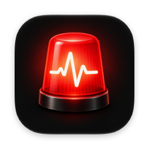
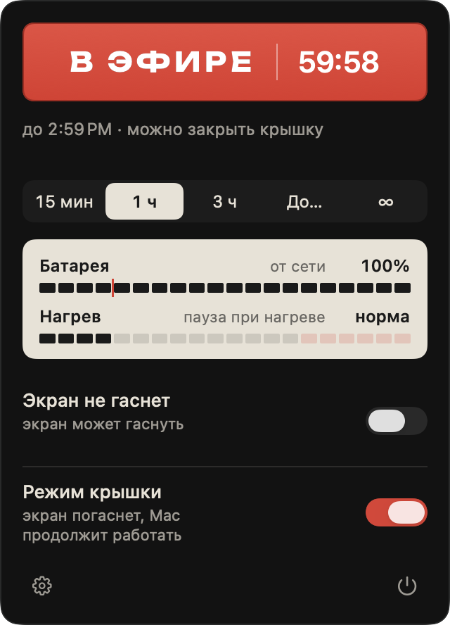
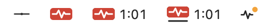
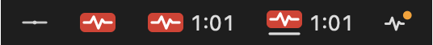

<p align="center">
  
</p>

<h1 align="center">Lidless</h1>

<p align="center">
  <b>Mac не засыпает, даже с закрытой крышкой, и никогда не остаётся без сна.</b><br>
  Нативное приложение для строки меню с табличкой «В ЭФИРЕ», на которую нажимаешь, чтобы выйти в эфир.
</p>

<p align="center">
  <a href="https://github.com/aesarva/lidless/releases/latest"></a>
  
  
  
  <a href="LICENSE"></a>
</p>

<p align="center">
  <a href="https://github.com/aesarva/lidless/releases/latest/download/Lidless.dmg"><b>Скачать Lidless.dmg</b></a>
  &nbsp;·&nbsp;
  <a href="CHANGELOG.md">Что нового</a>
  &nbsp;·&nbsp;
  <a href="README.md">English</a> · Русский
</p>

<p align="center">
  
</p>

> **Новое в 0.4.0:** Lidless обновляется сам. Новая версия появляется в панели и синей точкой на значке, одно нажатие её ставит. Сессия в эфире продолжается после перезапуска, включая режим крышки.

---

## Зачем Lidless

Большинство утилит против сна умеют одно: «не спать, пока крышка открыта». Lidless сделан для случаев, когда ты действительно отходишь от компьютера.

- **Работает с закрытой крышкой.** Экран гаснет, а Mac продолжает сборку, загрузку, рендер, работу AI-агента, SSH-сессию или трансляцию по AirPlay. Если подключён внешний монитор, Lidless экраны не трогает.
- **Сам себя страхует.** Останавливается при низком заряде, ставит режим крышки на паузу, если Mac нагрелся, и ограничивает время работы закрытого ноутбука от батареи, чтобы забытый MacBook не перегрелся в рюкзаке.
- **Никогда не ломает Mac.** Выход, падение, принудительное закрытие или перезагрузка: обычный сон всегда возвращается. Настройку сна, которую ты поменял сам, Lidless не трогает.
- **Одно нажатие.** Табличка «В ЭФИРЕ» и есть кнопка. На ней идёт обратный отсчёт сессии с таймером или время в эфире.
- **Понятно с первого взгляда.** В эфире значок в строке меню — маленькая горящая красная лампа, которая с таймером «выгорает». Оранжевая точка значит, что нужно твоё внимание.
- **Нативно и приватно.** SwiftUI + AppKit, универсальная сборка, один небольшой запрос за обновлениями в сутки, никакой аналитики и аккаунтов.

## Установка

1. [Скачай `Lidless.dmg`](https://github.com/aesarva/lidless/releases/latest/download/Lidless.dmg), открой его и перетащи **Lidless** в **Applications**.
2. Запусти. Lidless живёт только в строке меню, без значка в Dock.
3. При первом включении **режима крышки** macOS откроет **Системные настройки → Основные → Объекты входа и расширения**. Включи Lidless в разделе **Разрешить в фоновом режиме**. Это делается один раз, без пароля.

Релизы подписаны Developer ID и нотаризованы Apple. Нужна macOS 14 Sonoma или новее, Apple Silicon или Intel.

## Как пользоваться

1. Кликни по значку в строке меню.
2. Нажми табличку **В ЭФИРЕ** или выбери длительность (15 мин, 1 ч, 3 ч, *До…*, ∞), чтобы стартовать сразу с ней.
3. Собираешься закрыть крышку? Включи **Режим крышки**.
4. Нажми табличку ещё раз, чтобы выйти из эфира. Выход из Lidless тоже завершает сессию.

Esc или повторный клик по значку закрывает панель; правый клик открывает быстрое меню.

## Возможности

| | |
|---|---|
| **Сессии** | 15 мин, 1 ч, 3 ч (пресеты настраиваются), *До…* — до заданного времени, или бессрочно (∞). Выбор длительности запускает сессию или перезапускает текущую с новым сроком. |
| **Табличка** | Нажми (или Return), чтобы выйти в эфир и обратно. В эфире горит красным с обратным отсчётом или временем в эфире; вне эфира — тёмное стекло. |
| **Экран** | *Экран не гаснет* — экран горит; иначе экран может гаснуть, а Mac бодрствует. |
| **Режим крышки** | Mac работает с закрытой крышкой, экран при закрытии сразу гаснет. [Как это устроено](#режим-крышки). |
| **Приборы защиты** | Батарея и нагрев на панели как студийные шкалы, с отмеченным порогом батареи. |
| **Уведомления** | За 5 минут до конца сессии с таймером, с кнопками **+30 мин** и **+1 ч**; и когда правило защиты что-то остановило или поставило на паузу. |
| **Значок в строке меню** | Неброская линия вне эфира, горящая лампа в эфире, по желанию — оставшееся время рядом. |
| **Настройки** | Автозапуск при входе, длительность по умолчанию, пресеты, таймер в строке меню, старт при запуске, пороги защиты, помощник и язык интерфейса. |
| **Обновления** | Раз в сутки Lidless читает ленту на GitHub. Новая версия появляется в панели и синей точкой на значке; одно нажатие ставит её и перезапускает приложение. Сессия в эфире продолжается после обновления. Отключается в «Настройки → Основные» («Проверять обновления автоматически»). |
| **Языки** | Русский и английский; переключаются в «Настройки → Основные → Язык» независимо от языка системы. |

### Значок в строке меню

<p>
  
  <br>
  
</p>

Слева направо: **вне эфира** · **в эфире** · **в эфире с таймером** (лампа выгорает, рядом оставшееся время) · **режим крышки** (под лампой линия горизонта) · **нужно внимание** (сработало правило защиты или помощник недоступен).

### Правила защиты

| Правило | По умолчанию | Что происходит |
|---|---|---|
| Низкий заряд | вкл, 20% (5–50%) | От батареи ниже порога сессия останавливается и не запускается. |
| Нагрев | вкл | При *серьёзном* нагреве режим крышки ставится на паузу, а сессия идёт; при *критическом* с закрытой крышкой сессия останавливается. |
| Время с закрытой крышкой на батарее | вкл, 4 ч (30 мин–12 ч) | После этого режим крышки ставится на паузу. |

Любое правило можно выключить или настроить в «Настройки → Защита».

## Режим крышки

Обычные сессии используют стандартный запрет сна macOS и ничего дополнительно не требуют. Чтобы Mac не уснул с закрытой крышкой без внешнего монитора, нужна команда `pmset -a disablesleep 1`, а ей нужны права root. Поэтому Lidless несёт внутри приложения небольшого помощника-демона и регистрирует его в macOS через `SMAppService`; ты один раз разрешаешь его в «Объектах входа».

Когда крышка закрывается, Lidless гасит экран (`pmset displaysleepnow`, права не нужны) и не даёт Mac уснуть. Когда крышка открывается, снова действует твой выбор для экрана.

### Если что-то пошло не так

Режим крышки привязан к живому соединению Lidless с помощником, поэтому у обычного сна всегда есть путь назад:

| Если… | То… |
|---|---|
| Lidless закрылся, упал или закрыт принудительно | Помощник сразу возвращает обычный сон. |
| Mac перезагрузился посреди сессии | Помощник сбрасывает `disablesleep` при загрузке. |
| Помощник упал | macOS запускает его снова, и Lidless заново включает режим крышки. |
| Ты выключил Lidless в «Объектах входа» | macOS закрывает Lidless, обычный сон возвращается. |
| Ты сам выставил `disablesleep` | Lidless его не трогает. |

### Модель безопасности

- **Одна команда.** Единственное привилегированное действие помощника — `pmset -a disablesleep 0|1`. Кроме выбора «вкл/выкл», приложение не передаёт ему ни путей, ни аргументов. Единственное исключение: при первом запуске он удаляет помощника 0.2.0 (`launchctl bootout` задачи сторожа и удаление его файлов).
- **Подпись проверяется с обеих сторон.** Помощник принимает соединения только от Lidless с подписью той же команды Developer ID, а Lidless общается только с помощником этой команды. Ad-hoc сборки отклоняются с обеих сторон, а macOS вообще не запустит помощника, если его подпись больше не совпадает.
- **Один путь.** macOS привязывает помощника к пути приложения, поэтому запускай Lidless из одного места, например из `/Applications`.

| Путь | Назначение |
|---|---|
| `Lidless.app/Contents/MacOS/LidlessHelper` | демон-помощник; работает от root, macOS запускает его по требованию и при загрузке |
| `Lidless.app/Contents/Library/LaunchDaemons/io.github.aesarva.Lidless.helper.plist` | задача launchd, которую регистрирует `SMAppService` |
| `/Library/Application Support/Lidless/sleep-owned` | существует, только пока `disablesleep` включил помощник |

Нашёл проблему с безопасностью? См. [SECURITY.md](SECURITY.md).

### Переход с 0.2.0

Установи 0.3.0 поверх 0.2.0 и разреши нового помощника. Он удалит старое правило sudoers, скрипт-сторож и задачу launchd ещё до приёма соединений, а «Настройки → Помощник» это подтвердят. Если сессию режима крышки в 0.2.0 оборвали, Lidless сбросит `disablesleep` при запуске, даже до разрешения. Вручную ничего запускать не нужно.

### Удаление

«Настройки → Помощник → Удалить» (сначала выключит режим крышки, пароль не нужен), затем удали `Lidless.app`. Если приложение удалено раньше, выключи оставшуюся запись Lidless в **Системных настройках → Основные → Объекты входа и расширения**.

## Вопросы и ответы

**Нужен ли режим крышки с внешним монитором?**
Нет. С подключёнными монитором и питанием macOS и так не усыпляет закрытый Mac. Хватит обычной сессии, а экраны Lidless не трогает.

**Почему Lidless нет в Mac App Store?**
App Store не разрешает привилегированных помощников, а режиму крышки он нужен. Вместо этого релизы подписаны и нотаризованы.

**Не перегреется ли MacBook в рюкзаке?**
Для этого и есть правила защиты: при серьёзном нагреве режим крышки встаёт на паузу, при критическом нагреве с закрытой крышкой сессия завершается, а время с закрытой крышкой на батарее ограничено.

**Lidless что-то отправляет?**
Почти ничего. Единственный сетевой запрос — одно чтение ленты обновлений на GitHub в сутки. В нём нет данных о системе, заметки к выпуску не скачиваются. Отключается в настройках. Аналитики и аккаунтов нет. Заряд, источник питания, нагрев и датчик крышки читаются локально, только для правил защиты.

**Как обновить?**
Начиная с 0.4.0 — автоматически: панель показывает новую версию, одно нажатие ставит её. В Lidless 0.3.0 обновления нет, поэтому 0.4.0 нужно один раз скачать вручную; дальше всё пойдёт само.

## Сборка из исходников

Нужны Xcode 16 или новее и `brew install xcodegen shellcheck`.

```sh
make test      # тесты пакета, shellcheck, проверка plist помощника
make run       # собрать и запустить Debug-версию
make app       # Release, универсальная сборка → build/Lidless.app
```

Режим крышки работает только в сборках, подписанных Developer ID: помощник и приложение проверяют подпись друг друга.

```sh
SIGN_IDENTITY="Developer ID Application: <Имя> (<TEAMID>)" make app
```

Неподписанные сборки выполняют обычные сессии, а для режима крышки показывают «нужна подписанная сборка». Релизы, проверка на железе, отладочные режимы и структура проекта — в [CONTRIBUTING.md](CONTRIBUTING.md).

## Планы

- **Триггеры:** не спать, пока запущено приложение, при питании от сети, с монитором или в определённой Wi-Fi сети, во время загрузок, по расписанию.
- **Интеграции:** глобальная горячая клавиша, URL-схема, CLI, действия для «Команд».
- **Статистика и виджеты:** история сессий, виджет на рабочем столе, переключатель в Пункте управления.

Помощь приветствуется; порядок работы с ветками — в [CONTRIBUTING.md](CONTRIBUTING.md).

## Лицензия

Lidless — свободное ПО под [GNU General Public License v3.0](LICENSE).

Надпись на табличке набрана шрифтом [Unbounded](https://github.com/googlefonts/unbounded) (SIL Open Font License 1.1, лицензия приложена). Иконка приложения сгенерирована OpenAI gpt-image; подробности — в [docs/asset-provenance.md](docs/asset-provenance.md).
